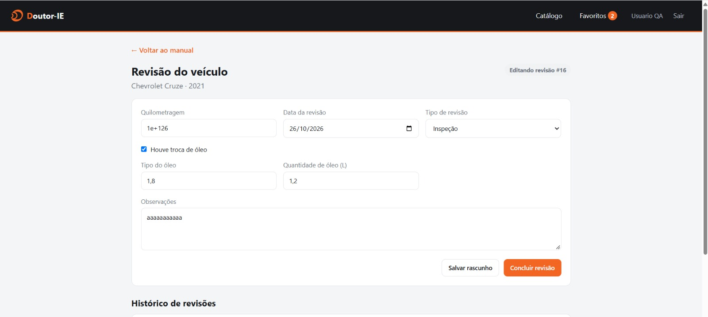
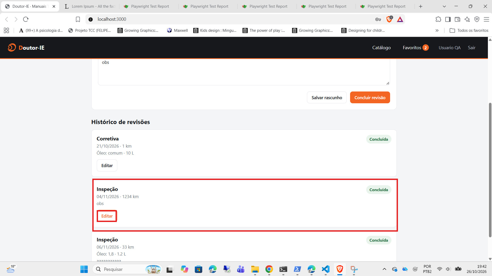
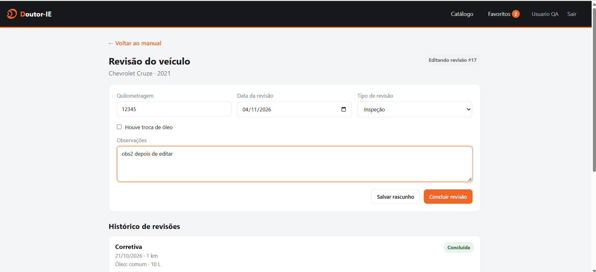
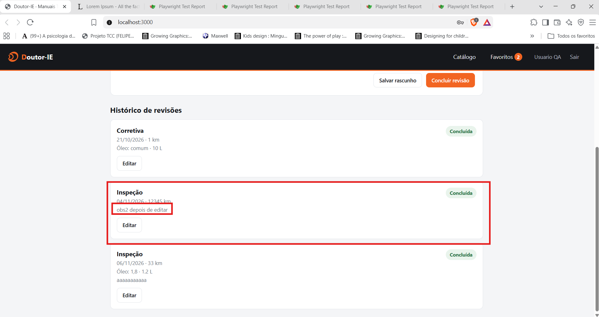
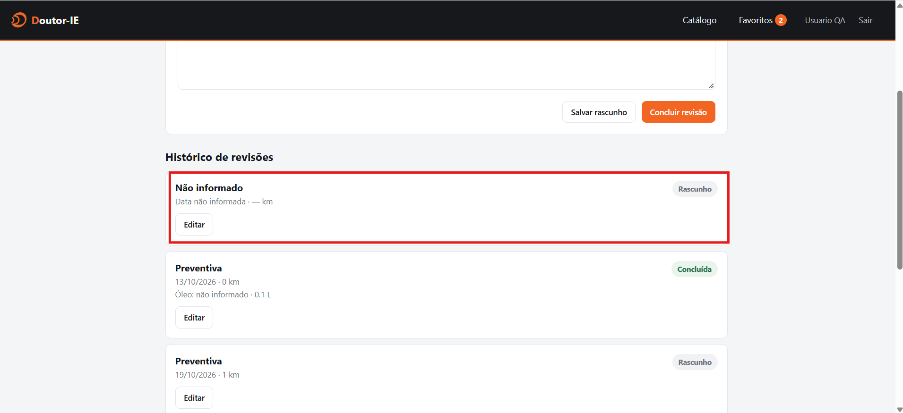
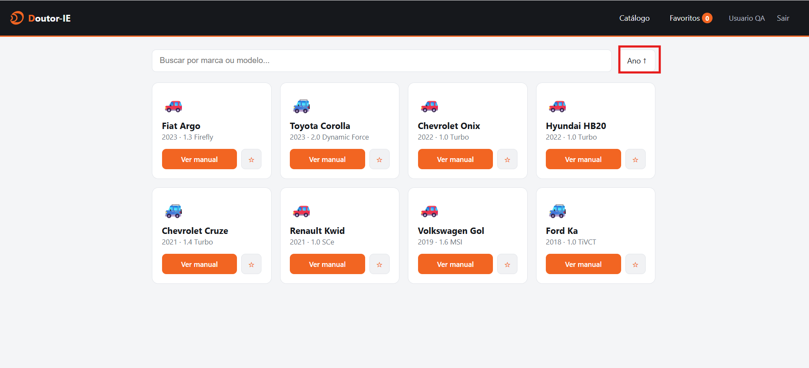
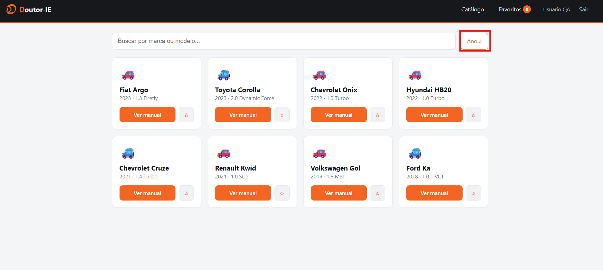
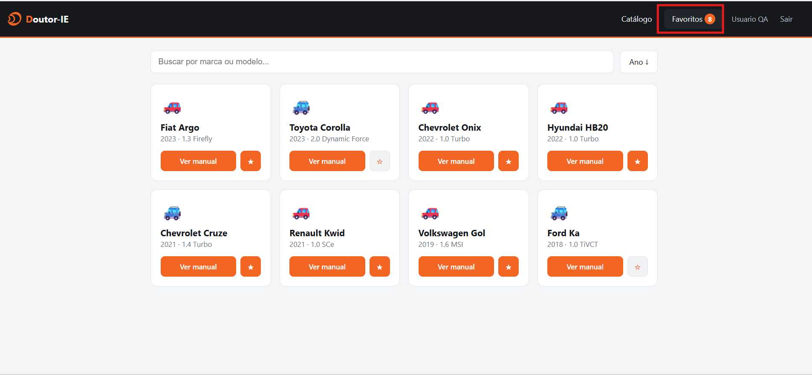
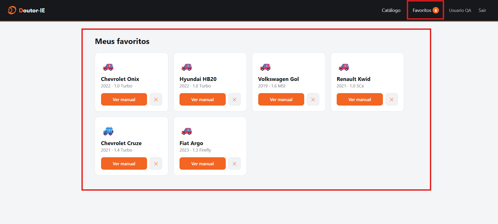
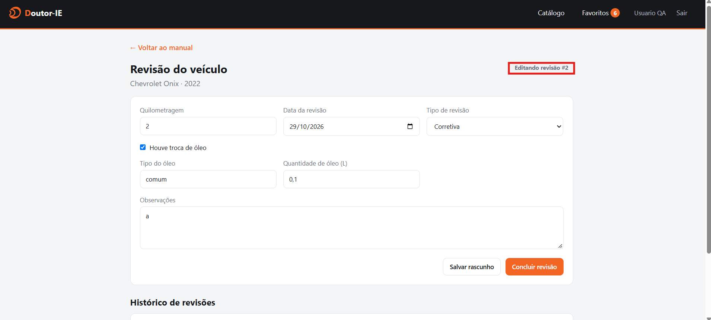

# Relatório de Bugs - Desafio Técnico Doutor-IE

### [BUG-01] Campo de "Observações" permite texto excessivo sem truncagem ou limite visual

- **Severidade:** Baixa
- **Onde:** Tela de Inclusão / Edição de Revisão (Módulo de Revisão do Veículo)
- **Passos para reproduzir:**
  1. Aceder a um veículo e iniciar ou editar uma revisão.
  2. No campo "Observações", inserir um texto muito longo (ex: múltiplos parágrafos de texto gerado).
  3. Clicar em "Concluir revisão".
- **Resultado esperado:** O sistema deveria aplicar uma validação de limite máximo de caracteres ou truncar o texto longo com um botão "Ver mais" para preservar a organização da interface.
- **Resultado obtido:** O sistema aceita o texto na íntegra e exibe o bloco de texto gigantesco diretamente no card do Histórico de Revisões, gerando poluição visual e quebrando a legibilidade do painel.
- **Evidência:** 
  

### [BUG-02] Campo de "Quilometragem" permite valores excessivos e notação científica (Overflow)

- **Severidade:** Média
- **Onde:** Campo de Quilometragem na Tela de Inclusão / Edição de Revisão
- **Passos para reproduzir:**
  1. Aceder a um veículo e iniciar ou editar uma revisão.
  2. No campo "Quilometragem", inserir uma sequência excessiva de dígitos (ex: vários noves seguidos que resultem em notação científica, como `1e+126`).
  3. Clicar em "Concluir revisão".
- **Resultado esperado:** O campo de quilometragem deveria restringir a entrada apenas a números inteiros válidos e positivos, aplicando um limite máximo razoável (ex: 999.999 km) com validação em tempo de execução.
- **Resultado obtido:** O sistema aceita o valor inválido/notação científica sem restrições, comprometendo a consistência lógica do histórico de manutenção do veículo.
- **Evidência:**

### [BUG-03] Sistema permite o registo de revisões com data no futuro

- **Severidade:** Alta
- **Onde:** Campo "Data da revisão" (Tela de Inclusão / Edição de Revisão)
- **Passos para reproduzir:**
  1. Aceder a um veículo e iniciar ou editar uma revisão.
  2. No campo "Data da revisão", selecionar ou introduzir uma data posterior ao dia atual.
  3. Preencher os restantes campos obrigatórios e clicar em "Concluir revisão".
- **Resultado esperado:** O sistema deve validar a data inserida e impedir a conclusão da revisão caso a data seja superior à data atual do sistema (impedindo manutenções "do futuro").
- **Resultado obtido:** O sistema aceita e guarda com sucesso a revisão com uma data futura, exibindo-a no histórico do veículo sem qualquer restrição.
- **Evidência:**
  

### [BUG-04] Sistema permite a edição e alteração de revisões já marcadas como "Concluída"

- **Severidade:** Média
- **Onde:** Histórico de Revisões do Veículo (Botão "Editar")
- **Passos para reproduzir:**
  1. Localizar no histórico uma revisão que já se encontra com o status **"Concluída"**.
  2. Clicar no botão "Editar" correspondente para abrir o formulário de edição.
  3. Modificar os dados e clicar em "Concluir revisão" para gravar por cima.
- **Resultado esperado:** Revisões com o estado "Concluída" deveriam estar bloqueadas para edição direta (modo somente leitura), permitindo alterações apenas através de um fluxo controlado de retificação.
- **Resultado obtido:** O sistema permite reabrir, alterar e gravar com sucesso os dados de uma revisão já finalizada, sobrescrevendo o registo sem restrições de bloqueio ou rasto de auditoria.
- **Evidências:**
  - **Passo 1 (Registo Inicial):**
    
  - **Passo 2 (Edição Ativa):**
    
  - **Passo 3 (Resultado Atualizado):**
    

### [BUG-05] Sistema permite regredir o status de uma revisão de "Concluída" para "Rascunho"

- **Severidade:** Média
- **Onde:** Histórico de Revisões / Formulário de Edição
- **Passos para reproduzir:**
  1. Localizar no histórico um registo de revisão com o status **"Concluída"**.
  2. Clicar no botão "Editar" correspondente para abrir o formulário.
  3. Clicar no botão **"Salvar rascunho"** em vez de concluir.
- **Resultado esperado:** Uma revisão que já foi concluída não deveria poder voltar a ser um rascunho através de uma simples edição, pois isso quebra o ciclo de vida padrão do documento.
- **Resultado obtido:** O sistema aceita a ação e faz a regressão do estado do registo, transformando uma revisão previamente validada/concluída novamente num simples "Rascunho".
- **Evidências:**
  - **Passo 1 (Estado Inicial Concluído):**
    
  - **Passo 2 (Ação de Edição / Salvar Rascunho):**
    
  - **Passo 3 (Estado Final Alterado para Rascunho):**
    

### [BUG-06] Sistema permite criar e salvar rascunhos de revisões completamente vazios (Registo Fantasma)

- **Severidade:** Baixa
- **Onde:** Módulo de Revisão do Veículo / Botão "Salvar rascunho"
- **Passos para reproduzir:**
  1. Aceder a um veículo e iniciar uma nova revisão.
  2. Deixar absolutamente todos os campos do formulário em branco.
  3. Clicar no botão **"Salvar rascunho"**.
- **Resultado esperado:** O sistema ou a especificação de requisitos deveria exigir pelo menos o preenchimento de campos obrigatórios mínimos antes de permitir a gravação de um rascunho.
- **Resultado obtido:** O sistema aceita o envio do formulário em branco e cria um registo no histórico exibindo "Não informado" e "Data não informada", poluindo a interface com dados inválidos.
- **Evidência:**
  

### [BUG-07] Funcionalidade de ordenação por ano não altera a listagem dos veículos ao alternar para decrescente

- **Severidade:** Média
- **Onde:** Tela Inicial / Catálogo de Veículos (Botão de Ordenação por Ano)
- **Passos para reproduzir:**
  1. Aceder ao catálogo de veículos na tela inicial.
  2. Clicar no botão de ordenação por ano para alternar entre `Ano ↑` e `Ano ↓`.
  3. Verificar a disposição dos cards de veículos na tela.
- **Resultado esperado:** Ao alternar o filtro para decrescente (`Ano ↓`), os veículos deveriam ser reordenados cronologicamente do ano mais recente para o mais antigo (ou vice-versa no ascendente).
- **Resultado obtido:** Independentemente do sentido da ordenação, a lista de veículos mantém-se estática na mesma ordem, sem refletir a alteração solicitada pelo utilizador.
- **Evidências:**
  - **Ordenação Ascendente (`Ano ↑`):**
    
  - **Ordenação Decrescente (`Ano ↓`):**
    

### [BUG-08] Contador de favoritos no menu superior não é atualizado após a remoção de um veículo

- **Severidade:** Baixa / Média
- **Onde:** Barra de Navegação Superior (Contador de Favoritos) e Tela "Meus Favoritos"
- **Passos para reproduzir:**
  1. Adicionar múltiplos veículos à lista de favoritos (verificar que o contador no menu superior reflete a quantidade correta).
  2. Aceder à tela de favoritos e remover um ou mais veículos da lista.
  3. Observar o número exibido na tag de favoritos no cabeçalho superior.
- **Resultado esperado:** O contador de favoritos na barra superior deveria decrementar em tempo real sempre que um veículo for removido da lista de favoritos, mantendo a consistência com os dados exibidos.
- **Resultado obtido:** O contador na barra superior permanece inalterado com o valor anterior, dessincronizando-se da quantidade real de veículos presentes na lista.
- **Evidências:**
  - **Estado Inicial (Contador com 8 itens):**
    
  - **Estado Atualizado (Menos itens na lista, mas contador continua em 8):**
    

### [BUG-09] Contador de edições de rascunho exibe identificador/contagem incorreta durante edições sucessivas

* **Severidade:** Média
* **Onde:** Cabeçalho do formulário de revisão ("Editando revisão #X")
* **Passos para reproduzir:**
  1. Acessar a página de detalhes de um veículo no catálogo (ex: Chevrolet Onix · 2022)[cite: 11].
  2. Iniciar uma nova revisão, preencher os dados e clicar em "Salvar rascunho".
  3. Clicar em "Editar rascunho" para reabrir a mesma revisão salva.
  4. Realizar alterações e clicar em "Salvar rascunho" novamente sucessivas vezes.
  5. Observar a tag/identificador exibida no canto superior direito do formulário ("Editando revisão #X")[cite: 11].
* **Resultado esperado:** O sistema deve manter a contagem e identificação correta da revisão que está sendo editada (ex: se for a primeira revisão rascunhada do veículo, manter o identificador fixo `#1` ou decrementar/incrementar conforme a lógica de versão esperada).
* **Resultado obtido:** O sistema incrementa incorretamente o número da edição a cada salvamento do mesmo rascunho (exibindo "Editando revisão #2", #3, etc.)[cite: 11], tratando salvamentos sucessivos do mesmo rascunho como se fossem revisões novas ou contagens de tentativas independentes.
* **Evidência:**
* **Evidência:**
  